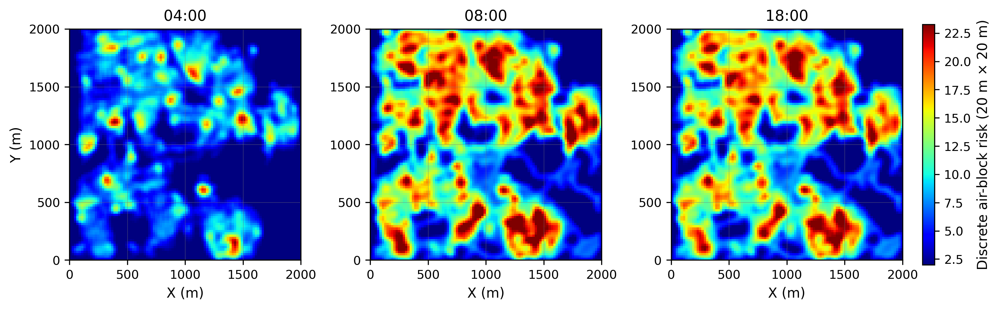
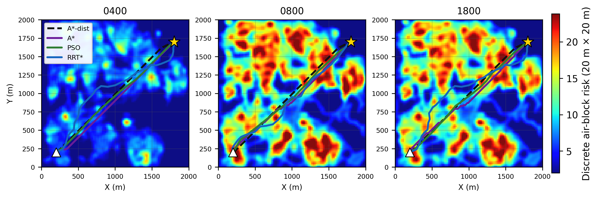

# path-planning-workshop

Code for the revision of **paper 1** — *three-dimensional dynamic risk modelling
and risk-aware path planning in urban land-cover scenes*.

The repository builds a 4D risk tensor (time × height × y × x) from
land-cover-derived layers and compares four planners on it:

| label     | planner                                             |
|-----------|-----------------------------------------------------|
| `A*-dist` | A* with a distance-only cost (the reference baseline) |
| `A*`      | risk-aware A* — traverses the 3D risk field          |
| `PSO`     | particle-swarm path search                           |
| `RRT*`    | sampling-based RRT* (steer + rewiring + goal bias)   |




## What the code does

1. **Risk model** (`rebuild_risk_model.py`) — per 2 m cell and per height layer:

   ```
   risk = 60 · (0.4·pop·R_f + 0.3·traffic·R_f·0.5 + 0.2·property + 0.1·noise)
   ```

   `R_f` is the cumulative fall-risk factor derived from impact energy, so risk
   decays with height. Buildings are hard obstacles (`100` in the tensor).
   The result is a `3 × 75 × 1000 × 1000` `float32` tensor (≈ 858 MB).

2. **Planning** (`algorithms.py`) — a seeded 26-connected 3D grid search plus
   PSO and RRT*, with the same metric set for every planner
   (`pl_m`, `rc`, `rc_norm`, `sm_max_deg`, `sm_sum_deg`, `steps`).

3. **Experiments** (`run_experiments.py`) — three groups: *time* (one district at
   04:00 / 08:00 / 18:00), *density* (low / medium / high-density districts at
   18:00) and *ablation* (static / +population / full).

4. **Analysis & figures** — `make_*.py` render every figure and table straight
   from `results/*.json`; nothing is transcribed by hand.

## Repository layout

```
.
├── config.py                 # every path used by the code lives here
├── algorithms.py             # planning core: Dijkstra / A* / PSO / RRT*
├── rebuild_risk_model.py     # layer stack -> 4D risk tensor (model v2)
├── build_ablation.py         # static / +pop / full ablation tensors
├── risk_tensor_tpr2.py       # tensor generation per district (raw vectors -> layers)
├── risk_tensor_tpr3.py
├── risk_tensor_tpr4.py
├── run_experiments.py        # time / density / ablation experiment runner
├── time_consistency.py       # does the ranking survive a time offset?
├── monte_carlo.py            # Monte-Carlo robustness of the ranking
├── exposure_metrics.py       # physical exposure along the planned paths
├── rerun_rrt.py              # re-run RRT* only, with more seeds
├── smoke.py                  # timing / validity probe before a full run
├── test.py                   # self-contained demo on a synthetic 100×100×30 map
├── make_figures.py           # shared styling + the first figure set
├── make_paper_figures.py     # final figure set (figure1 … figure10)
├── make_path_figures.py      # 3D path figures
├── make_risk_profile.py      # risk profiles along a path
├── make_time_figure.py       # time-of-day figure
├── make_mc_figure.py         # Monte-Carlo figure
├── make_tables.py            # LaTeX / CSV tables
├── data/                     # input data — NOT shipped, see data/README.md
├── figures/                  # generated figures (committed for convenience)
├── results/                  # experiment output, JSON
│   └── old_model/            # superseded v1 model, kept for comparison
├── tables/                   # generated tables (.tex/.csv)
└── else/                     # archived one-off scripts, see else/README.md
```

## Requirements

Python ≥ 3.9 with `numpy`, `scipy`, `matplotlib`, `geopandas` and `rasterio`
(the last two only for `risk_tensor_tpr*.py`):

```bash
pip install -r requirements.txt
```

## Data

The tensors are **not** in this repository: each one is ≈ 858 MB
(`3 × 75 × 1000 × 1000` `float32`), far above GitHub's 100 MB per-file limit,
and the underlying layers are derived from licensed land-cover and population
products.

Two ways to get a working copy:

**A. Point the code at an existing data folder**

```bash
export PPW_DATA_DIR=/path/to/data      # Windows: set PPW_DATA_DIR=D:\data
python run_experiments.py all
```

**B. Rebuild the tensors from the source vectors**

```bash
python risk_tensor_tpr2.py     # district 1 -> Layer_*.npy, env_tensor_4D_Final.npy
python risk_tensor_tpr3.py     # district 2
python risk_tensor_tpr4.py     # district 3
python rebuild_risk_model.py   # -> env_tensor_4D_v2.npy (the tensor the paper uses)
python build_ablation.py       # -> env_tensor_abl_{static,pop,full}.npy
```

The expected folder layout is documented in [`data/README.md`](data/README.md).

## Quick start without any data

`test.py` builds a synthetic 100 × 100 × 30 map in memory and runs every
planner on it — useful as a first check that the environment works:

```bash
python test.py
```

## Reproducing the paper

```bash
python run_experiments.py all   # ~ tens of minutes; writes results/*.json
python monte_carlo.py
python time_consistency.py
python exposure_metrics.py
python rerun_rrt.py             # optional: RRT* with more seeds

python make_figures.py
python make_paper_figures.py
python make_path_figures.py
python make_risk_profile.py
python make_time_figure.py
python make_mc_figure.py
python make_tables.py           # -> tables/*.tex, tables/*.csv
```

Experiment settings that the paper reports are the module constants in
`run_experiments.py`: `STEP = 5` (10 m planning grid obtained by 5× coarsening
of the 2 m tensor), start `(100, 100, 5)` m, goal `(900, 850, 60)` m,
`RRT_SEEDS = 10`, `PSO_SEEDS = 5`.

## Configuration

All paths are resolved in [`config.py`](config.py); no absolute path is
hard-coded anywhere in the pipeline.

| variable          | default            | meaning                        |
|-------------------|--------------------|--------------------------------|
| `PPW_DATA_DIR`    | `<repo>/data`      | input layers / tensors         |
| `PPW_RESULTS_DIR` | `<repo>/results`   | experiment output              |
| `PPW_PROJECT_DIR` | `<repo>/../revision` | only used by `else/ppt/*`    |

## License

MIT — see [LICENSE](LICENSE).

---

## 中文说明

本仓库是论文 1（三维动态风险建模与风险感知路径规划）修订版的可复现代码。

- **核心流程**：`rebuild_risk_model.py` 由地类/人口/交通/建筑图层生成
  `3×75×1000×1000` 的四维风险张量；`algorithms.py` 提供 A*（纯距离）、
  风险 A*、PSO、RRT* 四种规划器；`run_experiments.py` 跑时段、密度、消融三组实验；
  `make_*.py` 由图/表结果直接出图，不手工填数。
- **数据**：张量单个体积约 858 MB，超出 GitHub 单文件 100 MB 限制，故未上传。
  用 `PPW_DATA_DIR` 指向本地数据目录，或运行 `risk_tensor_tpr*.py` 与
  `rebuild_risk_model.py` 从原始矢量重新生成。
- **无需数据即可验证**：`python test.py`。
- **一次性脚本**：全部归档在 `else/` 下，见 `else/README.md`。
